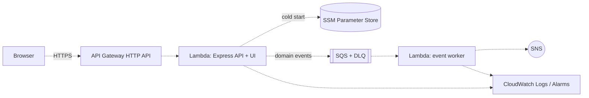

# EnterpriseOS on AWS

**An independent, cost-safe AWS cloud edition of EnterpriseOS**, a multi-tenant workforce-management
system. The unchanged Express application runs on **AWS Lambda** behind an **API Gateway HTTP API**,
with **SQS → Lambda → SNS** event processing, **SSM Parameter Store** secrets, **CloudWatch** logs and
alarms, and a single **AWS SAM / CloudFormation** template.

> ### Deployment status — 2026-11-25
> **Implemented Locally — not deployed to AWS.** All cloud code is written and covered by 56 passing
> tests, the template passes `cfn-lint`, and the built Lambda package passes a smoke test. Deployment
> target is the **AWS Academy Cloud Developing Sandbox**. Its service list has been verified (Lambda,
> API Gateway, SQS, SNS, CloudWatch, CloudFormation, SSM, S3 and CloudShell are all permitted), but
> the lab budget is *Used $0 of $40*, so the Academy cap is **US$2.00**
> ([environment audit](docs/aws-academy-environment-audit.md)). **No AWS resource exists yet.**
> Personal spending: **₹0**.

This repository is separate from the original Software Engineering project. It has its own Git
history and does not reference the original repository, Vercel deployment or database.

## Features (preserved from the original)

- JWT sign-in, bcrypt hashing, forced first-login password change, and the Super Admin / Admin / Manager / Employee roles
- Employee directory, departments, and manager → direct-report scoping
- Attendance clock-in/out in India time with search and CSV export
- Leave requests with overlap detection and manager approval
- Projects and a task execution board
- Dashboard, notifications, performance reviews, and an audit trail
- Tenant isolation on every query via the organisation claim in the token

## What the AWS edition adds

| Capability | Implementation |
|---|---|
| Serverless hosting | `aws/lambda/api-handler.js` + dependency-free loopback bridge (`http-bridge.js`) |
| Public HTTPS front door | API Gateway HTTP API with throttling and access logs, or a Lambda Function URL fallback |
| Secret management | SecureStrings in SSM Parameter Store, loaded at cold start (`config-loader.js`) |
| Event-driven processing | `LEAVE_DECIDED` / `TASK_ASSIGNED` → SQS (encrypted, TLS-only, DLQ) → worker Lambda → SNS |
| Observability | JSON logs with `X-Request-Id`, `/health` probe, CloudWatch alarms, optional dashboard |
| Infrastructure as code | [`infrastructure/template.yaml`](infrastructure/template.yaml) (SAM), least-privilege IAM or `LabRole` |
| CI/CD | Tests, audit, package smoke test, cfn-lint, ShellCheck and secret scan on every push; manual, confirmed deploy and cleanup workflows |
| Cost guard-rails | Pre-flight checks, cost checklist, throttling, retention limits, verified cleanup, and a test that rejects paid resource types |

## Architecture (summary)



Dashed lines mean implemented but not deployed. The full diagrams, with a legend that separates
deployed, implemented and proposed components, are in [`docs/architecture.md`](docs/architecture.md).

## Quick start (local, no AWS needed)

```bash
npm install
```

```bash
npm run dev
```

Open <http://localhost:4000>. Demo accounts (synthetic data, password `Demo@12345`):
`admin@demo.com`, `manager@demo.com`, `employee@demo.com`.

| Command | Purpose |
|---|---|
| `npm test` | All 56 tests (original + cloud) |
| `npm run package:lambda` | Build `dist/lambda` (runtime files and production dependencies only) |
| `npm run smoke:lambda` | Invoke the built package exactly as Lambda would |
| `npm run check:secrets` | Secret scan of tracked/staged files |
| `npm run aws:preflight` | Read-only AWS checks (needs the AWS CLI, e.g. in CloudShell) |
| `npm run aws:deploy` / `npm run aws:cleanup` | Guarded deploy / verified teardown |

## Documentation

| Document | Contents |
|---|---|
| [Baseline report](docs/baseline-report.md) | Repository audit before any change |
| [AWS Academy environment audit](docs/aws-academy-environment-audit.md) | What was verified, what was not, and how to finish the audit |
| [Architecture](docs/architecture.md) | Diagrams, request and event flows, data modes |
| [Architecture decisions](docs/architecture-decisions.md) | ADR-001 … ADR-009 |
| [AWS service matrix](docs/aws-service-matrix.md) | Every service with its purpose, status and cost risk |
| [Cost analysis](docs/cost-analysis.md) | Unit prices, per-resource estimates, worst cases |
| [Pre-deployment checklist](docs/pre-deployment-checklist.md) | Gate that must pass before provisioning |
| [Security](docs/security.md) | Controls, accepted risks, audit results |
| [Deployment guide](docs/deployment-guide.md) · [Cleanup guide](docs/cleanup-guide.md) | Step-by-step procedures |
| [Testing report](docs/testing-report.md) | Baseline vs final results and defects found |
| [Limitations and future work](docs/limitations-and-future-work.md) | Honest gaps and the production roadmap |
| [Evaluation guide](docs/evaluation-guide.md) | Viva answers, trade-offs and the demo script |
| [Demo-day runbook](docs/demo-day-runbook.md) | Minute-by-minute deployment and demo steps for the lab evaluation |
| [Lab submission pack](submission/) | Proposal, architecture sheet, 5-page report |
| [API reference](docs/api.md) · [Database](docs/database.md) | Application reference |
| [Evidence](docs/evidence/) | Raw outputs from real runs |
| [Legacy docs](docs/legacy/) | The original project's docs, kept for reference only |

## Repository layout

```text
aws/lambda/          Lambda handlers: API bridge, SSM loader, SQS worker
server/              Express application (business logic unchanged) + events/logger
public/              Browser SPA
infrastructure/      SAM template and reference IAM policies
scripts/             Packaging, smoke test, secret scan, scripts/aws/* deploy tooling
test/                node:test suites (original + cloud)
docs/                Documentation package and evidence
.github/workflows/   CI, manual deploy, manual cleanup
```

## License

MIT — see [LICENSE](LICENSE).
