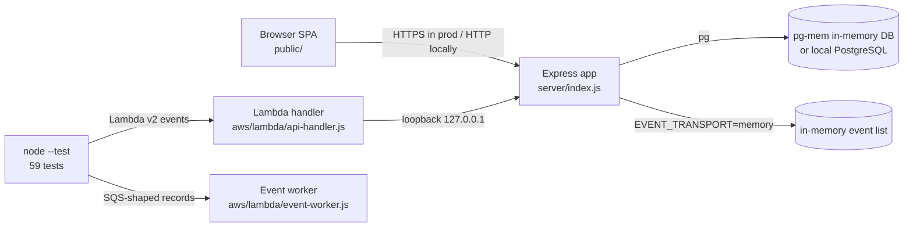
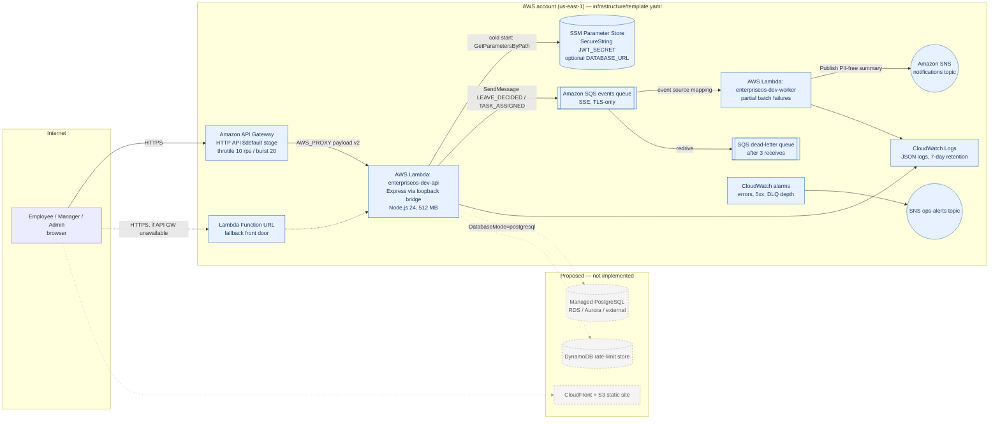
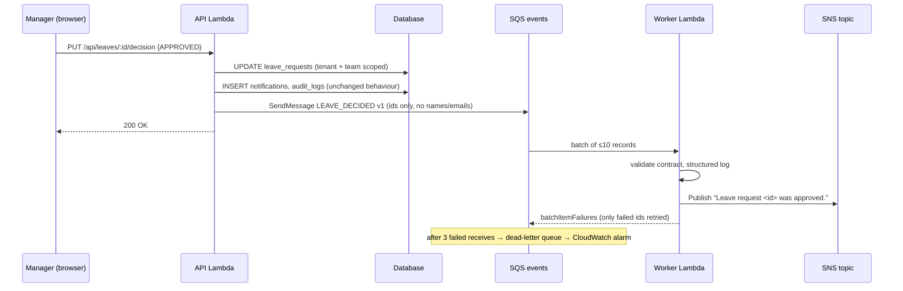

# Architecture

> **Deployment status (26 Nov 2026): deployed and verified** in the AWS Academy Cloud Developing
> Sandbox (us-east-1): stack `CREATE_COMPLETE`, `/health` 200, and a leave approval processed by the
> worker Lambda via SQS. Evidence: [`evidence/aws-deployment-2026-11-26.txt`](evidence/aws-deployment-2026-11-26.txt).
> The sandbox deletes the stack when its session ends; it is re-created for each demonstration.

## 1. Starting point (original EnterpriseOS)

EnterpriseOS is a multi-tenant workforce-management system: employees, departments,
projects, a task board, attendance (India time zone), leave approvals, performance
reviews, notifications, dashboards and an audit trail.

| Layer | Technology (verified from the code) |
|---|---|
| Frontend | Vanilla HTML/CSS/JS single-page app in `public/`, served by Express, token kept in `sessionStorage` |
| Backend | Node.js (ES modules) + Express 4, all routes in `server/index.js` |
| Auth | JWT (HS256, 8 h) via `jsonwebtoken`, bcrypt (12 rounds) passwords, role checks `SUPER_ADMIN / ADMIN / MANAGER / EMPLOYEE`, forced first-login password change |
| Data | PostgreSQL via `pg`; schema in `server/db.js#migrate()`; `pg-mem` in-memory database when `DATABASE_URL` is empty (development/tests) |
| Tenancy | Every query is scoped by `organization_id` from the JWT |
| Original hosting | Vercel serverless function (`index.js`) + Neon PostgreSQL — **not used or modified by this project** |

## 2. Diagram A — what runs today (verified locally)

Solid lines = verified running (local machine / CI). This is **not** an AWS deployment.

## 3. Diagram B — AWS architecture (deployed and verified on 26 Nov 2026)

**Legend.** Solid line = deployed and verified on AWS (26 Nov 2026, AWS Academy sandbox). Blue node = deployed component. Dashed blue line = implemented fallback (Function URL), not deployed. Grey dotted node/line = proposed future work (designed only).

## 4. Request flow (HTTP)

1. The browser calls `https://<api-id>.execute-api.us-east-1.amazonaws.com/...` (or the
   Function URL). TLS terminates at AWS.
2. API Gateway applies stage throttling and forwards a **payload v2.0** event to the API
   Lambda (`AWS_PROXY` integration).
3. **Cold start only** (`aws/lambda/api-handler.js`):
   1. `config-loader.js` reads allow-listed SecureStrings (`JWT_SECRET`, `DATABASE_URL`,
      `CORS_ORIGIN`) from `SSM_PARAMETER_PATH` — before the app module is imported,
      because the app validates its secrets at import time.
   2. The API's own origin (`https://` + `requestContext.domainName`, set by AWS) is added
      to the CORS allow-list so same-origin browser POSTs pass.
   3. The **unchanged** Express app is imported; in ephemeral-demo mode the schema and
      synthetic data are created in memory.
   4. The app listens on an ephemeral **127.0.0.1** port inside the sandbox.
4. `http-bridge.js` replays the event as a real HTTP request to that port, overwriting
   `X-Forwarded-For` with the AWS-verified `sourceIp`, then converts the response back
   (text vs base64, `Set-Cookie` → `cookies`).
5. Express runs exactly the same middleware as locally: security headers, CORS, 100 kB
   JSON limit, JWT auth, forced password change, role checks, tenant-scoped SQL.

Why a loopback bridge instead of a library such as `serverless-http`? It adds **no
dependency**, it exercises the real Node HTTP stack (so behaviour is identical to local
runs and to the existing tests), and it works unchanged for API Gateway and Function URLs.
The cost is ~1 ms of loopback overhead per request.

## 5. Event-driven flow (asynchronous)

* The synchronous notification/audit rows are still written exactly as before, so the
  product works even when `EVENT_TRANSPORT=none` (the local default).
* Publishing never fails a user request: errors are logged (`domain_event_publish_failed`).
* Event contract: `{ id, type, version: 1, occurredAt, organizationId, actorId, data }`.

## 6. Configuration and data modes

| Variable | Local default | AWS stack |
|---|---|---|
| `DATABASE_URL` | empty → pg-mem | from SSM when `DatabaseMode=postgresql` |
| `DEMO_EPHEMERAL_DATABASE` | unset | `true` when `DatabaseMode=ephemeral-demo` |
| `JWT_SECRET` | `.env` | SSM SecureString |
| `EVENT_TRANSPORT` | `none` | `sqs` |
| `REQUEST_LOGGING` | unset | `true` (JSON access logs) |

**Ephemeral-demo mode** exists so the full cloud architecture can be demonstrated with no
database cost. Seed IDs are deterministic (`server/seed.js#demoId`) so every Lambda
container starts with identical users, tasks and leave requests and JWTs work on any
container. *Writes* made in one container are not visible in another, and all data resets
on cold start. It is for demonstrations only; production still refuses the in-memory
database unless the flag is explicitly `true`.

## 7. What deliberately did not change

* No business logic, route, response shape, role rule or SQL semantics changed, except
  two pre-existing queries rewritten to an equivalent form (see
  [`testing-report.md`](testing-report.md#pre-existing-defects-found)).
* Local workflow is unchanged: `npm install && npm run dev`.
* The original repository, Vercel project and Neon database are not referenced by any
  code or configuration in this repository.
